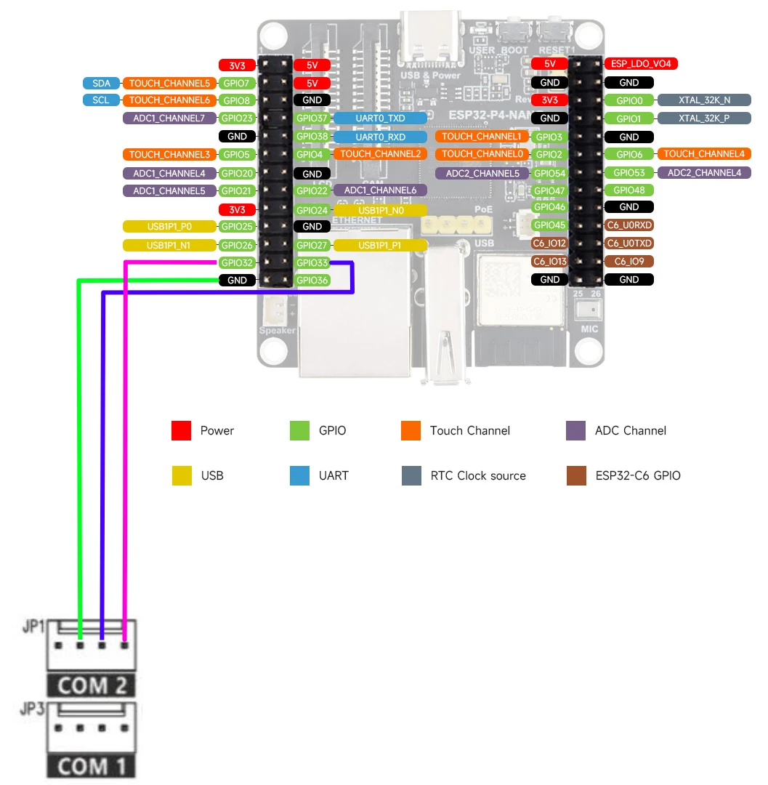

# Orisec Gateway — User Manual

Firmware **v1.0.6** · Hardware: Waveshare **ESP32‑P4‑NANO** · Panel: **Orisec CP20** (more models to follow)

The Orisec Gateway connects to an Orisec alarm panel and exposes it as a secure
web dashboard, and (optionally) to Home Assistant over MQTT.

> **Tested panels:** so far the gateway has been tested only with the **Orisec CP20**.
> Other Orisec panels use the same Contact ID serial protocol and are expected to work;
> support for further models will be confirmed as they're tested.

---

## Contents

1. [What you get](#1-what-you-get)
2. [Installing the firmware](#2-installing-the-firmware)
3. [Wiring to the panel](#3-wiring-to-the-panel)
4. [First boot & finding the gateway](#4-first-boot--finding-the-gateway)
5. [Logging in](#5-logging-in)
6. [Using the web dashboard](#6-using-the-web-dashboard)
7. [Settings](#7-settings)
8. [Home Assistant via MQTT](#8-home-assistant-via-mqtt)
   - [8.1 Create the MQTT user on Mosquitto](#81-create-the-mqtt-user-on-mosquitto)
   - [8.2 Configure MQTT on the gateway](#82-configure-mqtt-on-the-gateway)
   - [8.3 What appears in Home Assistant](#83-what-appears-in-home-assistant)
9. [Troubleshooting](#9-troubleshooting)
10. [Security notes](#10-security-notes)

---

## 1. What you get

- A secure (HTTPS) web dashboard to view and control the panel: zones, partitions
  (areas), outputs, a virtual keypad, and system status.
- Real‑time updates (arm/disarm, zone activity, faults).
- Optional Home Assistant integration over MQTT with auto‑discovery.
- Time kept in sync from the internet (NTP) and pushed to the panel.

**Defaults (out of the box, v1.0.6):**

| Setting | Default |
|---|---|
| Panel connection | **Onboard UART** (GPIO32 TX / GPIO33 RX) @ 9600 8N1 |
| Web server | **HTTPS**, auto self‑signed certificate |
| Login | **admin / admin** (you're forced to change it on first login) |
| MQTT | **Off** (turn on in Settings when you want Home Assistant) |

---

## 2. Installing the firmware

The easiest way is the browser installer — no tools to install.

1. On a desktop running **Chrome** or **Edge**, open:
   **https://grantfen.github.io/orisec-gateway-firmware/**
2. Connect the ESP32‑P4‑NANO to your computer with a USB cable.
3. Click **Connect & Install** and choose the board's serial port.
4. Choose **Install** and wait ~1–2 minutes.

> **First install only:** you may be offered a full‑flash *erase*. That's fine for
> a new board, but it wipes any saved settings and resets the login to `admin/admin`.

**Manual alternative** (any OS, needs Python):

```
pip install esptool
esptool --chip esp32p4 -p <PORT> write-flash 0x0 orisec-gateway-1.0.6.bin
```

Replace `<PORT>` with your serial port (e.g. `COM4` on Windows, `/dev/ttyUSB0` on Linux).

---

## 3. Wiring to the panel

By default the gateway talks to the panel over **onboard UART** — a direct 3.3 V
TTL connection, **no level shifter needed**.

### Step 1 — set the panel's Com port to CID Serial

On the Orisec panel, in the **engineer programming menu**, configure **Com 1** *or*
**Com 2** as **CID Serial** (Contact ID over serial). The gateway communicates using
the Contact ID protocol, so the panel port it's wired to **must** be in this mode —
otherwise the gateway can't talk to the panel. Note which Com port you chose; that's
the one you wire to in Step 2.

### Step 2 — wire the gateway to that Com port

| ESP32‑P4‑NANO | Panel Com port (set to CID Serial) |
|---|---|
| **GPIO32** (TX) | panel **RX** |
| **GPIO33** (RX) | panel **TX** |
| **GND** | **GND** |

- Serial format: **9600 baud, 8N1**.
- Do **not** use GPIO37/38 (console) or GPIO0 (boot) on the ESP32.



*Example wiring to the panel's **Com 2** connector (JP1): **GPIO32** and **GPIO33** carry the serial data and **GND** is the common ground. If you set **Com 1** (JP3) to CID Serial in Step 1 instead, wire to that connector the same way.*

> **Panel user code:** the gateway sends a panel **user/access code** with every
> command. Set it in **Settings → Panel Connection → Panel User Code** so it matches
> a valid code configured on your panel.

Other transports (USB‑to‑TTL adapter, or UDP to a network‑connected panel) can be
selected later in **Settings → Panel Connection**.

---

## 4. First boot & finding the gateway

On first boot the gateway:

1. Gets an IP address by **DHCP** (hostname `orisec-gateway`).
2. Generates its HTTPS certificate — this takes **~30 seconds** the first time, so
   give it a moment before the web page responds.
3. Connects to the panel over UART.

**Find its IP address** from your router's DHCP client list (look for
`orisec-gateway`), then browse to:

```
https://<gateway-ip>/
```

> Your browser will warn about the certificate (it's self‑signed). This is expected —
> choose **Advanced → Proceed** to continue.

---

## 5. Logging in

- Default credentials: **`admin` / `admin`**.
- You'll be prompted to **set a new password** on first login — do this and keep it safe.
- To add users or change passwords later: **Settings → Users**.

> If you ever get locked out, a **Factory Reset** (Settings) or re‑flashing with a
> full erase returns the login to `admin/admin`.

---

## 6. Using the web dashboard

The sidebar has six pages:

- **Zones** — live state of every zone (clear, active, tamper, fault, alarm,
  bypassed). Click a zone to **bypass/unbypass** it.
- **Partitions** — each area's state with **Arm (A)**, **Part/Stay Arm (P)** and
  **Disarm (D)** buttons.
- **Keypad** — a virtual keypad mirroring the panel's LCD.
- **Outputs** — toggle the panel's programmable outputs on/off.
- **System** — power (mains / battery voltage, AC and battery status), and the panel
  status flags (general fault, battery, fuse, tamper, comms, engineer on site).
- **Settings** — everything below.

> **Arming behaviour:** a full **Arm** takes effect immediately. A **Part-arm**
> starts a fixed **exit timer** of about **30 seconds** before it sets. This is a
> behaviour of the Orisec panel over this interface — the ~30 s is fixed and is **not**
> changed by the exit-time setting programmed in the panel, so there is nothing to adjust
> there. The same applies when arming from Home Assistant (full arm is immediate;
> part/home arm runs the exit timer).

The top bar on every page shows **CONNECTED/DISCONNECTED**, last update time, and
**AC** / **BATT** status at a glance.

---

## 7. Settings

**Settings → …** covers:

- **Users** — add/remove users, change passwords.
- **Network** — DHCP or static IP, hostname.
- **Security** — session timeout, password.
- **Time** — NTP servers, timezone; force an NTP resync and push time to the panel.
- **Panel Connection** — transport (**UART** / USB / UDP), GPIO pins, baud, UDP
  IP/ports, and the **Panel User Code** (the access code the gateway sends with every
  command — it must match a valid user code on your panel). *Changes apply on reboot.*
- **MQTT** — see the next section.

---

## 8. Home Assistant via MQTT

Home Assistant talks to the gateway through an **MQTT broker**. The usual broker is
the **Mosquitto broker** add‑on running inside Home Assistant. There are three steps:

1. Create a login the gateway will use (section 8.1).
2. Point the gateway at the broker (section 8.2).
3. Home Assistant auto‑discovers the device (section 8.3).

### 8.1 Create the MQTT user on Mosquitto

The gateway's default MQTT username is **`Orisec`** — create a matching login on the
broker. Pick **one** of these methods.

**Method A — a Home Assistant user (recommended for the Mosquitto add‑on).**
The Mosquitto add‑on accepts Home Assistant user accounts as MQTT logins.

1. In Home Assistant: **Settings → People → Users → Add User**.
2. Display name: `Orisec`, **Username: `Orisec`**, set a password.
3. (Optional) Turn off "Administrator" and mark it "Local only" — it only needs to
   be an MQTT login.
4. Create the user. Note the username (`Orisec`) and password for the next step.

**Method B — a Mosquitto add‑on local login.**

1. **Settings → Add‑ons → Mosquitto broker → Configuration**.
2. Under `logins`, add:
   ```yaml
   logins:
     - username: Orisec
       password: your-strong-password
   ```
3. **Save**, then **Restart** the add‑on.

> Make sure the Home Assistant **MQTT integration** is set up and pointing at the
> Mosquitto broker: **Settings → Devices & Services → MQTT**. If MQTT isn't added
> yet, add it there first.

### 8.2 Configure MQTT on the gateway

On the gateway: **Settings → MQTT**.

| Field | Value |
|---|---|
| **Enable MQTT** | On |
| **Broker URI** | `mqtt://<home-assistant-ip>:1883` |
| **Username** | `Orisec` (default) |
| **Password** | the password you set in 8.1 |
| **Client ID** | `gateway` (default) |
| **Base topic** | `orisec` (default) |
| **Home Assistant discovery** | On |

Replace `<home-assistant-ip>` with your Home Assistant / broker address (e.g.
`mqtt://192.168.0.100:1883`). For a TLS broker use `mqtts://host:8883`.

**Save** and **reboot** the gateway. Within a few seconds it connects to the broker
and publishes its discovery messages.

### 8.3 What appears in Home Assistant

Once connected, Home Assistant automatically creates a single device —
**"CP20 by Orisec"** — with:

- **Controls**
  - **Area 1 / Area 2** — alarm panels you can arm away, arm home, and disarm.
  - **Output 3/4/5** and **Remote 1/2** — switches.
- **Sensors**
  - **Battery Fault, Comms Fault, Fuse Fault, General Fault, Tamper** — OK / problem.
  - **Mains Power** — On/Off. **Panel Online** — connected/disconnected.
  - **Battery Voltage, System Voltage** — in volts.
  - **Engineer On Site**, and one sensor per **Zone** (clear/active).
- **Activity** — a live log of state changes (arming, zones, outputs, faults).

No YAML is needed — everything is created by MQTT discovery. If you later disable
discovery or change the base topic, remove the old device in Home Assistant and let
it re‑discover.

---

## 9. Troubleshooting

**The web page won't load.**
- Give it ~30 s on first boot (certificate generation).
- Confirm the IP from your router (hostname `orisec-gateway`).
- Use `https://` (not `http://`) and accept the self‑signed certificate warning.

**Panel shows "Disconnected".**
- Confirm the panel's **Com 1** or **Com 2** is set to **CID Serial** in the engineer
  menu, and that you wired the gateway to *that* Com port.
- Check the UART wiring (TX↔RX crossed, common GND).
- Confirm **Settings → Panel Connection** is **UART**, pins GPIO32/33, **9600** baud.
- If your panel uses a different serial speed, set the matching baud and reboot.

**Home Assistant doesn't show the device.**
- Confirm the gateway's MQTT shows connected (web **Settings → MQTT**, or the
  gateway isn't reporting an MQTT error in its status).
- Check the username/password match the broker login (section 8.1) exactly —
  `Orisec` is case‑sensitive.
- Confirm the broker URI/port and that Home Assistant's MQTT integration is running.
- Ensure **Home Assistant discovery** is On.

**Forgotten login.** Factory Reset in Settings (or re‑flash with a full erase)
returns the login to `admin/admin`.

---

## 10. Security notes

- Change the default `admin` password immediately.
- The web server is HTTPS with a self‑signed certificate; you can upload your own in
  **Settings** if you prefer.
- MQTT is **off by default** — only enable it when you've set up a broker login.
- Keep the gateway on a trusted local network; it is not intended to be exposed
  directly to the internet.

---

*Orisec Gateway · firmware v1.0.6 · installer: https://grantfen.github.io/orisec-gateway-firmware/*
